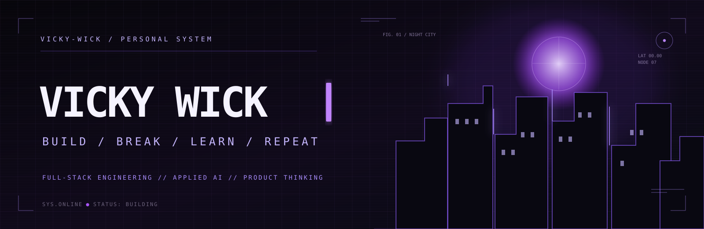

<div align="center">



# VIKASH KUMAR ADHIKARI

**Computer Science Engineer · Applied AI · Full-Stack Development**

[GitHub](https://github.com/vicky-wick) · [Email](mailto:vadhikari2023@gift.edu.in)

</div>

---

### `whoami`

I build software where **engineering, AI, and product thinking** meet. I like taking ideas from rough prototypes to useful, working products — especially developer tools, full-stack applications, and LLM-powered systems.

```text
FOCUS     → Applied AI / RAG / LLM applications
BUILD     → Full-stack products / APIs / backend systems
EXPLORE   → System design / Web3 / developer infrastructure
MINDSET   → Learn fast. Build deliberately. Ship often.
```

### `toolkit`

<p>
  
</p>

**AI / Data:** Hugging Face · Llama · RAG · FAISS · Chroma · NumPy · Pandas  
**Core:** REST APIs · Authentication · Databases · System Design

### `selected_work`

| Project | What it explores |
|---|---|
| **Multimodal RAG** | Retrieval across documents and media, embeddings, vector search, and local LLM inference |
| **PRITHVILOK** | Climate-tech platform concept for environmental monitoring, waste management, and community action |
| **Unbothered** | AI-assisted mental wellness product concept |

### `currently`

- Building practical full-stack applications.
- Experimenting with retrieval pipelines and LLM-powered workflows.
- Getting sharper at backend architecture, deployment, and system design.

---

<div align="center">

### `github / telemetry`


**LESS TALK. MORE SHIP.**

<sub>Designed in the terminal · Powered by curiosity</sub>

</div>
